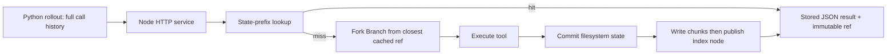

# Architecture and invariants



LayerFS is the authoritative storage backend. The local backend is a reference
implementation for development that copies file trees; it has no LayerFS claims.

## Identity

Scope is SHA-256 of canonical JSON `{schema, namespace, task, baseRef, tools,
context, epoch}`. `baseRef` is pinned at service startup by forking the seed and
taking its head Commit, or its base Layer when no Commit exists. A mutable Branch
name is never stored as the execution state of a cache node.

`tools` fingerprints all names, versions, mutation and cacheability flags.
`context` must identify dependencies not present in the snapshot: runtime image,
dataset revision, remote model or corpus, relevant environment variables. We do
not guess whether arbitrary external dependencies changed. JSON object order is
normalized; arrays retain order and numeric values are finite IEEE-754 numbers.
The Node API rejects non-JSON/cyclic values. Python data crosses a JSON wire; keep
integers within JavaScript's exact integer range when precision matters.

`key = SHA256({parent: stateKey, call: {name, arguments}, version})`. Initially
`stateKey = root`. A mutating call advances `stateKey` to its key. A read-only
call is a leaf off the current state node and leaves `stateKey` unchanged. This
is the TVCache stateful-chain optimization. It relies on the declared semantics
of the tools; returned observations/model messages do not independently affect
filesystem state. Include any relevant observation-derived value in subsequent
tool arguments.

## Lookup and execution

Walk the history in order. Each cached node supplies its value and filesystem
ref. After the longest usable state prefix, a miss forks from that ref and
executes only the missing tool. No replay of preceding stateful tools is needed.
Subsequent misses fork from each newly saved state. Independent `run` requests
can evaluate any history. An explicit rollout session retains its previous steps,
ref, state key and cacheability barrier: incremental submissions may only append
identical-history calls. This preserves uncached/random/external effects once
within that rollout rather than re-executing them on every growing-history call.
Each new execution still forks an immutable filesystem ref.

Rollout sessions bind the initial task/scope for their lifetime, have an explicit
close operation and a default admission limit of 1024. An executed tool failure
marks its session failed; it must not resume by replaying uncertain effects. The
persistent shared cache survives normal service restarts, whereas session IDs do
not. Unknown session IDs are refused rather than silently recreated.

All calls are validated before any execution. Concurrent same-scope/key misses
share one in-flight promise. This optimization is process-local. Cache record
publication is serialized on the index Branch; each execution owns its own
Branch, avoiding mutation of a cached state. One service is the writer authority
for a project/index. Its private exclusive lock must be shared by every candidate
owner; it is never stolen on a timeout or a PID guess.

## Persistence

`lc-index-<namespace-hash>` contains:

```text
/.layercache-v1/nodes/<scope>-<key>      small JSON manifest
/.layercache-v1/blobs/<content-hash>-0   base64 chunk
/.layercache-v1/blobs/<content-hash>-1   base64 chunk
```

The decoded record contains `schema, scope, key, parent, call, mutates, value,
ref, executionMs, createdAt, expiresAt`. Chunks encode at most 12 KiB of JSON
bytes each (16 KiB base64). The small manifest is written **last**, by one atomic
LayerFS file write. A failure before publication leaves unreachable chunks;
it never exposes a partial result as a hit. SHA-256 checks the reconstructed
record. Index paths are derived hashes, not user-controlled task names.

The `lc-run-*` Branch head after the tool is the snapshot reference. For direct
file tools, `fs.apply` writes parent folders and content atomically. For shell,
`sandbox.create → mount → exec → commit → unmount → sandbox.close` is explicit;
nonzero command exit is committed as history but the `shell` tool rejects it, so
no cache node is published. Read-only tools cannot invoke writes or shell through
their environment facade, and their final snapshot must match their input ref.

## Invalidation and failure

Changing task, context, namespace, seed or tool version yields a fresh scope.
TTL adds `floor(now / ttlMs)` to the scope, invalidating a complete chain together.
A run pins that scope for its duration; if an entry expires during a very long
run, remaining calls bypass reuse. Noncacheable calls disable reuse for the whole
remaining history. External effects are outside LayerFS rollback and must be
handled by the tool author.

Tool failures do not publish nodes. An uncertain LayerFS/transport mutation is
attempted once. Check the Store's history and logs before manual recovery. The
service drains active requests before releasing its owner lock. A crash leaves
the lock for an operator to inspect. Ordinary close/reopen retains records;
LayerFS's Disposable Store does not guarantee crash or power-loss recovery.

Pruning removes node manifests, including optional task/time filters. Descendant
nodes remain independently usable from their own immutable refs. Neither old
blobs nor execution Branches/Commits are reclaimed through the 1.1.0 public API.
The index is an invocation graph, not complete process/sandbox checkpointing.
